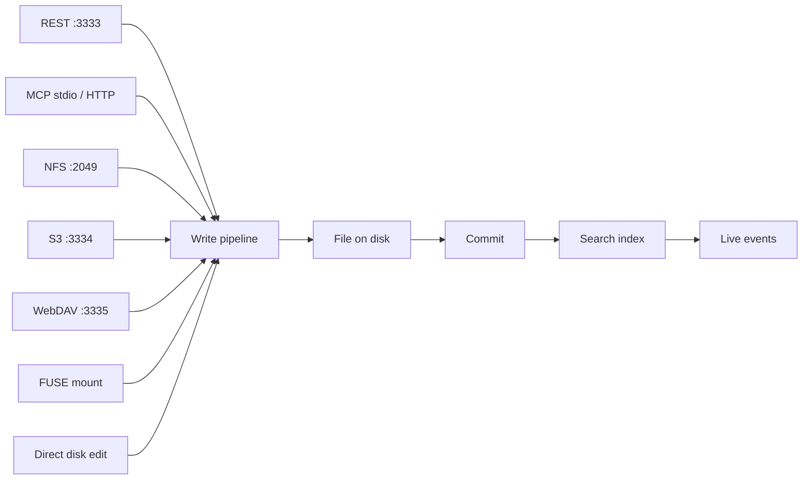

An agent can reach KiwiFS through a mounted filesystem, the REST API, MCP, or a plain `llms.txt` index. Every route lands on the same files, and every write goes through the same pipeline, so the choice is about what your agent's environment supports.

| Interface | Pick it when |
| --- | --- |
| Filesystem | The agent has shell access and a mounted folder |
| REST | The agent can make HTTP calls but has no mount |
| MCP | The agent runs in an MCP client such as Claude or Cursor |
| `llms.txt` | The agent only knows how to fetch a URL |

## Filesystem

With a local folder or a mount (NFS, FUSE, WebDAV, or S3), the agent uses commands it already knows. No SDK, driver, or custom protocol.

```bash Terminal
cat /kiwi/concepts/authentication.md
grep -r "timeout" /kiwi/
echo "# New finding" > /kiwi/reports/finding-042.md
```

Writes made directly on disk are picked up by the file watcher, then committed and indexed like any other write.

## REST API

```bash Terminal
# Read a file
curl 'http://localhost:3333/api/kiwi/file?path=concepts/auth.md'

# Write a file, with attribution and provenance
curl -X PUT 'http://localhost:3333/api/kiwi/file?path=reports/finding.md' \
  -H 'X-Actor: agent:researcher' \
  -H 'X-Provenance: run:run-249' \
  --data-binary '# Finding...'

# Search
curl 'http://localhost:3333/api/kiwi/search?q=timeout'
```

See the [API overview](/api/overview) for every endpoint.

## MCP

MCP is the most structured interface: 78 tools covering files, search, DQL, drafts, refactoring, memory, workflows, task claims, graph analytics, imports, and more.

```bash Terminal
kiwifs mcp --root ~/knowledge                 # in-process over stdio, no server needed
kiwifs mcp --remote http://localhost:3333     # proxy to a running server
kiwifs mcp --root ~/knowledge --http          # Streamable HTTP on port 8181
```

A running `kiwifs serve` also exposes MCP at `/mcp`. Agents should call `kiwi_context` first to load the schema, playbook, index, and rules. See [MCP](/concepts/mcp) for client setup and the full tool reference.

## llms.txt

`GET /llms.txt` lists every page grouped by folder with links, following the [llms.txt](https://llmstxt.org) convention. `GET /llms-full.txt` returns every page's markdown in one response, truncated with a notice past a size cap. When auth is enabled, both list only public or published pages.

## One pipeline for every protocol



| Protocol | Use case | Start it |
| --- | --- | --- |
| REST | Web UI, scripts, agents | Always on with `kiwifs serve` |
| MCP | Agents in MCP clients | `kiwifs mcp`, or `/mcp` on the server |
| NFS | Docker and Kubernetes native mounts | `kiwifs serve --nfs` |
| S3 | `aws s3`, `rclone`, data pipelines | `kiwifs serve --s3` |
| WebDAV | Mapped drives, desktop tools | `kiwifs serve --webdav` |
| FUSE | Developer workstations | `kiwifs mount --remote http://server:3333 ~/kiwi` |

Setup for each: [Alternate protocols](/guides/alternate-protocols).

## Attribution and provenance

Tell KiwiFS who is writing and why. Both work on any write.

| REST header | MCP argument | Effect |
| --- | --- | --- |
| `X-Actor: agent:researcher` | `actor` | Becomes the git commit author. Defaults to `anonymous` over REST and `mcp-agent` over MCP. |
| `X-Provenance: run:run-249` | `provenance` | Appends `{type: run, id: run-249, date, actor}` to the page's `derived-from` frontmatter |

The `type:id` format is required; a malformed value is ignored. Later, find everything a run produced:

```bash Terminal
curl -G 'http://localhost:3333/api/kiwi/meta' \
  --data-urlencode 'where=$.derived-from[*].id=run-249'
```

<Tip>
Use the `ETag` from a read as `If-Match` (REST) or `if_match` (MCP) on the next write. If another agent changed the page in between, your write fails with a conflict instead of overwriting their edit.
</Tip>

## Related

<CardGroup cols={2}>
  <Card title="MCP" icon="plug" href="/concepts/mcp">
    Client setup and all 78 tools.
  </Card>
  <Card title="Agent playbook" icon="book-open" href="/concepts/agent-playbook">
    The files that onboard an agent to a knowledge base.
  </Card>
  <Card title="Alternate protocols" icon="network-wired" href="/guides/alternate-protocols">
    NFS, S3, WebDAV, and FUSE setup.
  </Card>
  <Card title="Task claims" icon="lock" href="/concepts/claims">
    Keep agents from editing the same page at once.
  </Card>
</CardGroup>
