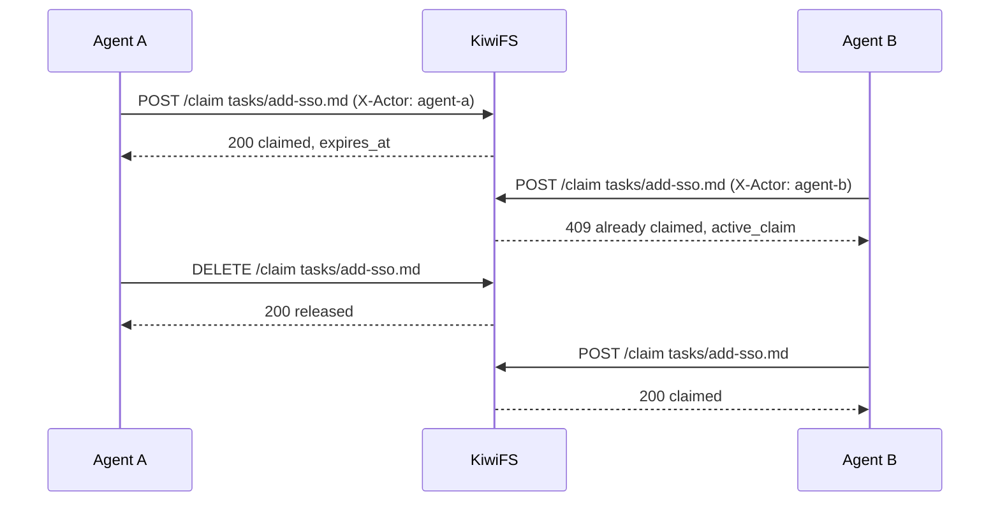

A claim is a **lease** on a path. An agent claims a page before working on it, and other agents that try to claim the same page get `409 Conflict` until the lease expires or the holder releases it. Use claims when several agents pull work from the same pool of pages, such as a task board or a review queue.

Claims are **cooperative**. They do not block writes: a page stays editable by anyone, and agents are expected to check or take a claim first. For protection against overwriting someone else's edit, use [ETags and `If-Match`](/api/overview#optimistic-concurrency).

## How it works



- The claim holder is the value of the **`X-Actor`** header (or the `actor` argument over MCP). Give every agent a distinct actor name.
- Claiming a path you already hold renews the lease.
- Only the holder can release a claim. Another actor gets `403`.
- An expired lease is free for anyone to claim. KiwiFS also sweeps expired claims every 30 seconds.
- The path must exist. Claiming a missing file returns `404`.

## Lease duration

Pass `lease_duration` as a duration string such as `15m`, `1h`, or `90s`.

| Value | Result |
| --- | --- |
| Omitted | 30 minutes |
| Under 1 minute | Raised to 1 minute |
| Over 24 hours | Rejected with `400` |

Pick a lease that covers the work with some margin, and renew it by claiming again if the work runs long.

## Claim, work, release

<Tabs>
  <Tab title="REST">
    ```bash Terminal
    curl -X POST 'http://localhost:3333/api/kiwi/claim' \
      -H 'Content-Type: application/json' \
      -H 'X-Actor: agent:builder-1' \
      -d '{"path": "tasks/add-sso.md", "lease_duration": "45m"}'
    ```

    ```json Response
    {
      "path": "tasks/add-sso.md",
      "claimed_by": "agent:builder-1",
      "claimed_at": "2026-10-19T09:00:00Z",
      "expires_at": "2026-10-19T09:45:00Z"
    }
    ```

    When the work is done, release the claim:

    ```bash Terminal
    curl -X DELETE 'http://localhost:3333/api/kiwi/claim' \
      -H 'Content-Type: application/json' \
      -H 'X-Actor: agent:builder-1' \
      -d '{"path": "tasks/add-sso.md"}'
    ```
  </Tab>
  <Tab title="MCP">
    Call `kiwi_claim` with `path`, `actor`, and an optional `lease_duration`. Release with `kiwi_release` using the same `actor`. `kiwi_claims_list` shows every active claim. `kiwi_task_create` can create a task and claim it in one call with `claim: true`.
  </Tab>
</Tabs>

A conflicting claim returns the current holder so the agent can move on to other work:

```json 409 Conflict
{
  "error": "already claimed",
  "active_claim": {
    "path": "tasks/add-sso.md",
    "claimed_by": "agent:builder-1",
    "claimed_at": "2026-10-19T09:00:00Z",
    "expires_at": "2026-10-19T09:45:00Z"
  }
}
```

`GET /api/kiwi/claims` lists active claims.

## Claims and restructuring

[Refactor plans](/concepts/refactor) respect claims. A plan that would move or merge a page someone else has claimed fails with an error naming the holder. A plan that only rewrites links inside a claimed page succeeds with a warning. When a move does go through, the claim follows the page to its new path.

## Storage

Claims live in `.kiwi/state/claims.db`, a SQLite file that is not versioned. Claims are on by default; if the database cannot be opened, the claim endpoints return `503` with `claims not enabled`.

## Related

<CardGroup cols={2}>
  <Card title="Claims REST API" icon="lock" href="/api/claims">
    Claim, release, and list endpoints.
  </Card>
  <Card title="Workflows" icon="bars-progress" href="/concepts/workflows">
    Move claimed tasks across a Kanban board.
  </Card>
  <Card title="Agent playbook" icon="book" href="/concepts/agent-playbook">
    Patterns for agents sharing a knowledge base.
  </Card>
  <Card title="MCP" icon="plug" href="/concepts/mcp">
    `kiwi_claim`, `kiwi_release`, and `kiwi_claims_list`.
  </Card>
</CardGroup>
