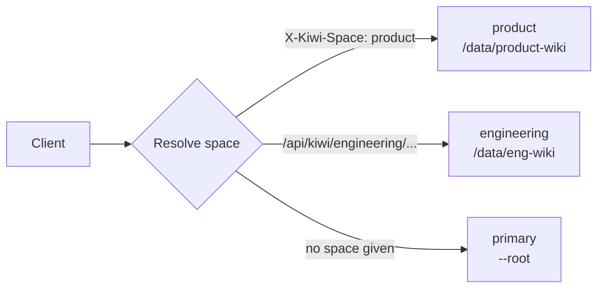

A **space** is one knowledge base: a root directory with its own git history, search index, and `.kiwi/state/`. Multi-space mode serves several spaces from one KiwiFS process and port. Use it for separate team wikis on one host, per-tenant knowledge bases, or workspaces you create on demand.

## How it works



- The **primary** space is the directory you pass to `--root`. It is named `default` unless you set `[space] name`. Requests that name no space go here.
- **Additional** spaces come from `--space` flags, `[[spaces]]` in the primary's `config.toml`, or `POST /api/spaces`.
- Each space has its own write pipeline, so writes, events, claims, webhooks, and the audit log stay within that space.

## Add spaces

<Tabs>
  <Tab title="config.toml">
    ```toml knowledge/.kiwi/config.toml
    [space]
    name = "handbook"   # optional name for the primary space

    [[spaces]]
    name = "engineering"
    root = "/data/eng-wiki"

    [[spaces]]
    name = "product"
    root = "product-wiki"   # relative paths resolve against --root
    ```

    ```bash Terminal
    kiwifs serve --root ./knowledge
    ```
  </Tab>
  <Tab title="CLI flags">
    ```bash Terminal
    kiwifs serve --root ./knowledge \
      --space engineering=/data/eng-wiki \
      --space product=/data/product-wiki
    ```

    `--space` takes `name=path` and can repeat. If a name appears in both a flag and `[[spaces]]`, the flag wins.
  </Tab>
  <Tab title="REST">
    ```bash Terminal
    curl -X POST 'http://localhost:3333/api/spaces' \
      -H 'Content-Type: application/json' \
      -d '{"name": "research", "template": "research"}'
    ```

    Without `root`, the space is created at `{primary root}/.spaces/{name}`, hidden from the primary space's file tree. `template` picks a `kiwifs init` template and defaults to `blank`. Spaces created this way are saved to `.kiwi/spaces.json` in the primary root and restored on restart.
  </Tab>
</Tabs>

<Warning>
Every space runs with the **primary space's `config.toml`**. A space's own `.kiwi/config.toml` is not read at startup, so settings such as `[search]`, `[auth]`, and `[space] visibility` are shared across spaces.
</Warning>

## Route requests to a space

KiwiFS resolves the space for each request in this order:

| Priority | Method | Example |
| --- | --- | --- |
| 1 | `X-Kiwi-Space` header | Set by a reverse proxy that maps subdomains to spaces |
| 2 | URL prefix | `/api/kiwi/engineering/tree` is served as `/api/kiwi/tree` in `engineering` |
| 3 | Primary space | Any request with neither |

<CodeGroup>
```bash Path prefix
curl 'http://localhost:3333/api/kiwi/engineering/file?path=index.md'
```

```bash Header
curl 'http://localhost:3333/api/kiwi/file?path=index.md' \
  -H 'X-Kiwi-Space: engineering'
```
</CodeGroup>

If `X-Kiwi-Space` names a space that does not exist, the request returns `404` instead of falling back to the primary space. A URL prefix that is not a space name is treated as part of the normal path.

The header works on every route, including `/p/...`, `/raw/...`, `/mcp`, and the web UI. That makes subdomain routing straightforward:

```text Caddyfile
*.wiki.example.com {
  @space header_regexp space Host ^([a-z0-9-]+)\.wiki\.example\.com$
  request_header @space X-Kiwi-Space {re.space.1}
  reverse_proxy localhost:3333
}
```

## Web UI

The space selector in the sidebar switches between spaces. Page URLs show which space you are in:

| Space | Page URL |
| --- | --- |
| Primary | `/page/{path}` |
| Any other | `/s/{space}/page/{path}` |

## Authentication per space

With `type = "perspace"`, each API key can be limited to one space. A key without `space` works in every space.

```toml knowledge/.kiwi/config.toml
[auth]
type = "perspace"

[[auth.api_keys]]
key = "kiwi_sk_eng_..."
space = "engineering"
actor = "eng-team"

[[auth.api_keys]]
key = "kiwi_sk_admin_..."
actor = "admin"
```

<Warning>
The space management routes under `/api/spaces` are not covered by API key auth. On a shared network, block or authenticate `/api/spaces` at your reverse proxy.
</Warning>

## Manage spaces

| Method | Path | Purpose |
| --- | --- | --- |
| `GET` | `/api/spaces` | List spaces with `fileCount`, `sizeBytes`, and `lastModified` |
| `GET` | `/api/spaces/{name}` | One space's summary |
| `POST` | `/api/spaces` | Create a space from `name`, optional `root`, and optional `template` |
| `DELETE` | `/api/spaces/{name}` | Unregister a space |
| `GET` | `/api/init-templates` | Templates available for `template` |

Deleting a space renames its root directory to `{root}.deleted-{timestamp}`, so the files stay recoverable and the name is free to reuse.

## Agents and MCP

Each space serves its own Streamable HTTP MCP endpoint. Reach it at `/mcp` with an `X-Kiwi-Space` header; without the header, `/mcp` serves the primary space. For a stdio MCP client, point `kiwifs mcp` at the server and pick a space:

```bash Terminal
kiwifs mcp --remote http://localhost:3333 --space engineering
```

In local mode, `--root` already selects one knowledge base directly, so `--space` is rejected. Use `kiwifs mcp --root /data/eng-wiki` instead.

## Related

<CardGroup cols={2}>
  <Card title="Spaces API" icon="server" href="/api/spaces">
    Create, list, and delete spaces.
  </Card>
  <Card title="Configuration" icon="gear" href="/configuration#multi-space">
    `[space]` and `[[spaces]]` syntax.
  </Card>
  <Card title="Draft spaces" icon="code-branch" href="/concepts/draft-spaces">
    Temporary branches of one knowledge base.
  </Card>
  <Card title="Authentication" icon="key" href="/guides/auth-tokens">
    API keys, per-space keys, and OIDC.
  </Card>
</CardGroup>
