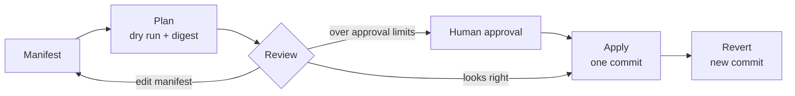

Restructuring reorganizes a knowledge base from a **manifest**: a short YAML or JSON list of moves, merges, and edits. KiwiFS turns it into a **plan** you can review, then applies the whole thing as one git commit that you can revert.

Every link to a moved page is respelled in the style it was written in — full path, short name, relative path, markdown link, table cell — and re-resolved to prove it still reaches the same page. A plan that would break a working link is rejected. Comments, personal state, frontmatter field ownership, and task claims follow their pages.

Use it whenever you would otherwise rename files by hand and fix links afterwards: renaming a folder, archiving old drafts, folding duplicate pages together, or letting an agent reorganize a messy knowledge base under review.

<Info>
Single renames go through the same engine. Moving a page from the sidebar file tree, `kiwi_rename`, and the REST rename endpoints all relink and never overwrite an existing destination. The **Move / Rename** item in a page's **More actions** menu is the exception: it copies and deletes without rewriting links.
</Info>

## How it works



<Steps>
<Step title="Write a manifest">
Describe what should change. Paths are relative to the knowledge root. A destination ending in `/` is a folder that keeps each file's name.

```yaml reorg.yaml
moves:
  - from: guides/old-name.md          # one file
    to:   guides/new-name.md
  - from: drafts/                     # a folder and everything in it
    to:   archive/drafts/
  - from: "notes/**/*-meeting.md"     # a glob; ** spans folders
    to:   meetings/
merges:
  - from: faq/duplicate.md            # deleted; its links, comments and state go to into
    into: faq/canonical.md
delete_empty_dirs: true
```
</Step>
<Step title="Plan it">
Planning writes nothing. It returns every move and merge, every rewritten link, content edits, comment and state files that follow their pages, folders that become empty, warnings, errors, and a **digest** that identifies exactly this plan.

```bash Terminal
kiwifs refactor plan reorg.yaml --root ./knowledge --verbose
```

A plan with errors (a taken destination, a link that cannot be kept, a protected path) cannot be applied.
</Step>
<Step title="Review it">
Read the plan in the terminal (`--diff` prints a unified diff per page), in the web UI's **Restructure** view, or as JSON. Change the manifest and plan again until it is right.
</Step>
<Step title="Apply it">
Apply with the digest you reviewed. If any affected file changed since, nothing is written and you get the fresh plan to review instead. Everything lands in one commit, which the response names.

```bash Terminal
kiwifs refactor apply reorg.yaml --root ./knowledge
```
</Step>
<Step title="Revert if needed">
Revert puts every page and comment or state file back byte for byte, as a new commit. It refuses if any of those files changed after the commit, so it never discards later work. Revert requires git versioning.

```bash Terminal
kiwifs refactor revert 3f9c2ab --root ./knowledge
```
</Step>
</Steps>

## Run it

<Tabs>
<Tab title="CLI">
`kiwifs refactor` has three subcommands. `apply` and `revert` show the plan and ask for confirmation unless you pass `--yes`.

```bash Terminal
kiwifs refactor plan reorg.yaml              # preview only
kiwifs refactor plan reorg.yaml --diff       # with a unified diff per page
kiwifs refactor apply reorg.yaml --yes       # apply without prompting
kiwifs refactor revert <commit>              # preview, confirm, revert
```

If a KiwiFS server is already serving `--root`, `apply` and `revert` send the change to that server (at `--server`, default `http://127.0.0.1:<port from config>`) so its index and live readers stay consistent. Otherwise they apply directly. `kiwifs refactor plan` exits `1` when the plan has errors.

See [`kiwifs refactor`](/cli/commands#refactor) for every flag.
</Tab>
<Tab title="MCP">
Agents use four tools:

| Tool | Use |
| --- | --- |
| `kiwi_refactor_plan` | Preview a manifest. `detail`: `summary` (default), `full` (every link with line numbers), or `diff`. Page with `offset` and `limit`. |
| `kiwi_refactor_apply` | Apply with the same `manifest` and the plan's `digest`. Pass the plan's `now` back if it reports one. |
| `kiwi_refactor_script` | Compute a manifest with a Starlark program, then plan it. |
| `kiwi_refactor_revert` | Preview a revert without `digest`; apply with the preview's `digest`. |

The manifest can be passed as YAML or JSON text, or as an object. A full plan is also readable as the resource `kiwi://refactor/plans/{digest}`.

Prefer one plan over a loop of `kiwi_rename` calls: one review, one commit, one revert.
</Tab>
<Tab title="REST">
```bash Terminal
# Plan (body is the manifest itself, YAML or JSON)
curl -X POST http://localhost:3333/api/kiwi/refactor/plan \
  -H "Authorization: Bearer $KIWI_API_KEY" \
  --data-binary @reorg.yaml

# Apply the reviewed plan
curl -X POST http://localhost:3333/api/kiwi/refactor/apply \
  -H "Authorization: Bearer $KIWI_API_KEY" \
  -H "Content-Type: application/json" \
  -H "X-Actor: alice" \
  -d '{"manifest": {"moves": [{"from": "drafts/", "to": "archive/drafts/"}]}, "digest": "<digest from plan>"}'

# Preview, then apply, a revert
curl -X POST http://localhost:3333/api/kiwi/refactor/revert \
  -H "Authorization: Bearer $KIWI_API_KEY" \
  -H "Content-Type: application/json" \
  -d '{"commit": "3f9c2ab", "dry_run": true}'
```

See [REST endpoints](#rest-endpoints) for the full list and status codes.
</Tab>
<Tab title="Web UI">
Click the **Restructure: move and merge pages** button in the sidebar.

1. Paste a manifest (YAML or JSON) and click **Plan**.
2. Review before and after trees, moves and merges, relinked pages, content edits, integrity, and per-file diffs. Uncheck an item to drop it: the manifest is rewritten and planned again.
3. Click **Apply**. The footer shows the commit, and **Undo** reverts it.

The view also lists plans agents are **Waiting for your approval** (click **Approve for** the agent) and files **Moved outside KiwiFS**, with **Review the fix** to relink them.
</Tab>
</Tabs>

## Manifest reference

Unknown keys are an error, so a typo cannot silently drop part of a restructuring. Selection always sees the workspace as it was before the manifest.

<AccordionGroup>
<Accordion title="moves — files, folders, globs, regular expressions">
| Form | Example | Notes |
| --- | --- | --- |
| File | `{from: guides/a.md, to: guides/b.md}` | |
| Folder | `{from: drafts/, to: archive/drafts/}` | Moves everything inside. |
| Glob | `{from: "notes/**/*-meeting.md", to: meetings/}` | `**` spans folders and `{a,b}` alternates. Paths below the glob's fixed prefix are kept. |
| Regex | `{from_regex: 'journal/(\d{4})-.*\.md', to: 'journal/$1/'}` | Matches whole paths. `$1` and `${name}` expand in the destination. |

Destinations must not exist. Destinations that collide by case or Unicode normalization, or are not portable file names, are reported as `conflicts` with a code: `exists`, `many_to_one`, `case_or_normalization`, `forbidden_chars`, `too_long`, `trailing_dot_or_space`, `empty_name`, `dir_cycle`, `parent_is_file`, `is_folder`.

A page claimed by another actor cannot be moved.
</Accordion>

<Accordion title="merges — fold a duplicate into a canonical page">
```yaml
merges:
  - from: faq/duplicate.md
    into: faq/canonical.md
```

`from` is deleted. Every link, comment, and personal-state entry that pointed at it now points at `into`. The body of `into` is not changed — write the combined page first, then run the merge. `into` can be a current path or the path a move in the same manifest gives it.
</Accordion>

<Accordion title="edits — change frontmatter and text of selected pages">
```yaml
edits:
  - select: {query: 'status = "draft"', glob: "notes/**"}
    set: {status: archived}
    unset: [reviewer]
    add_tags: [archived]
    remove_tags: [wip]
    replace: [{find: "Acme Corp", with: "Acme"}]
```

`select` takes `paths`, `glob`, and a DQL `query`. Every criterion narrows the selection, and at least one is required (use `glob: "**"` to mean everything). `replace` only touches body text outside frontmatter and code; add `regex: true` to use an RE2 pattern with `$1` captures.

Frontmatter is edited line by line, so comments, key order, and alignment survive, and a retag is a one-line diff per page. Keys owned by another agent are refused unless the edit sets `force: true`.

Edits can also compute values per page:

- `when:` keeps only pages where an expression is true, for example `year(date) < "2024" and "draft" in tags`.
- `compute: {key: expr}` sets a key to an expression's value.
- `move_to: "archive/{{year}}/{{slug}}.md"` moves each page to a templated path. `on_conflict: suffix("-%d")` numbers collisions deterministically; otherwise they are conflicts.

Expressions use [expr](https://expr-lang.org) over the page before the manifest: `path`, `dir`, `name`, `stem`, `title`, `tags`, `fm`, `links`, `date`, `modified`, `now`, with `slug()`, `year()`, `month()`, `day()`, and `date(t, layout)`. A plan that uses expressions reports the `now` it used. Put it in the manifest (`now:`) or pass it to `kiwi_refactor_apply` so the digest still matches.
</Accordion>

<Accordion title="rename_tags — rename a tag everywhere">
```yaml
rename_tags:
  - {from: ml, to: machine-learning}
```

Covers frontmatter `tags` lists and inline `#tags` in the body. Renaming into a tag that already exists is a warning.
</Accordion>

<Accordion title="split — one page per heading">
```yaml
split:
  - from: guides/handbook.md
    level: 2                  # split at ## headings (default 2)
    into: guides/handbook/    # default: a folder named after the page
    confirm: true             # a split is preview-only until confirmed
```

Each section becomes its own page, titled with its heading. The original page becomes an index linking to them. Links to `handbook#heading` follow their section, and each section's own links are re-resolved from its new folder.
</Accordion>

<Accordion title="relinks — repair moves made outside KiwiFS">
```yaml
relinks:
  - {from: old/path.md, to: new/path.md}
```

Moves that bypass the engine — WebDAV or NFS renames, files moved on disk while the watcher runs, `kiwi_rename` with `update_links: false` — are logged when anything referenced the old path. `relinks` respells those references without moving anything. Folders work too. `GET /api/kiwi/refactor/raw-moves` (or the resource `kiwi://refactor/raw-moves`) builds this manifest for you.
</Accordion>

<Accordion title="delete_empty_dirs and now">
- `delete_empty_dirs: true` removes folders the plan leaves empty.
- `now:` pins the clock expressions see (an RFC 3339 timestamp).
</Accordion>
</AccordionGroup>

## Scripts

When globs, DQL, and expressions are not enough, compute the manifest with a [Starlark](https://github.com/google/starlark-go) (Python-like) program. It runs in a separate, sandboxed process and can only read:

| Function | Returns |
| --- | --- |
| `query(dql)` | Matching paths |
| `files(glob)` | Matching paths |
| `read(path)` | Page text |
| `frontmatter(path)` | Frontmatter as a dict |
| `links(path)` | Outgoing link targets |
| `slug(text)` | A file-name slug |

`json` and `print` are also available. Steps, memory, time, and reads are bounded, and there are no `while` loops or recursion. Return the manifest from `main()`:

```python archive_done.star
def main():
    return {"moves": [{"from": p, "to": "archive/"} for p in query('status = "done"')]}
```

Nothing is written. The script's manifest is planned, and you apply it like any other with its digest. Run scripts with `kiwi_refactor_script` or `POST /api/kiwi/refactor/script` (body `{"script": "..."}`); the response holds `manifest`, `output` (what the script printed), and `plan`.

## Guardrails

<AccordionGroup>
<Accordion title="Standing rules in config.toml">
```toml .kiwi/config.toml
[refactor]
protect = ["policies/**", "SCHEMA.md"]  # globs no plan may write, delete, or move
scope = "notes/"                        # the only folder plans may touch
folder_map = "meta/folders.md"          # page listing where pages belong; other folders warn
approval_files = 50                     # default 50; -1 disables
approval_links = 200                    # default 200; -1 disables
```
</Accordion>

<Accordion title="Agent approval">
An agent (MCP, or REST with `X-Kiwi-Client: mcp/...`) applying a plan that writes or deletes more than `approval_files` files, or rewrites more than `approval_links` links, needs a person's approval:

- If the MCP client supports elicitation, the user is asked to confirm in the client.
- Otherwise the plan waits in `GET /api/kiwi/refactor/pending` until a person approves it — in the web UI's **Restructure** view, or with `POST /api/kiwi/refactor/approve`. An approval lets the agent apply that exact digest once within the hour.

The REST apply endpoint answers `428` when approval is required.
</Accordion>

<Accordion title="Integrity report">
Every plan reports `integrity`: how many links in the written pages point nowhere (these were already broken — the plan never breaks a working link) and which pages a merge leaves with no inbound links.

`stats` counts pages and links checked, links rewritten, and links that already pointed nowhere and were left exactly as written.
</Accordion>

<Accordion title="Transactional apply">
Applying re-checks every file's ETag inside the write lock and writes a journal of pre-images first (`.kiwi/state/refactor-journal.json`). If the process dies mid-apply, the next start rolls it back unless the commit landed. A failed commit rolls the whole restructuring back.

The commit carries trailers: `Kiwi-Actor`, `Kiwi-Client`, `Kiwi-Refactor-Digest`, `Kiwi-Manifest`, and `Kiwi-Base`.
</Accordion>
</AccordionGroup>

## Editor integration

`kiwifs lsp` is a language server for markdown. When your editor is about to rename or move files (`workspace/willRenameFiles`), it answers with the link edits computed by the same planner. Point your editor's generic LSP client (VS Code, Zed, Neovim) at it:

```bash Terminal
kiwifs lsp --root ./knowledge
```

The editor performs the rename itself, so comments and personal state do not follow the page. Use `kiwifs refactor` or the web UI when they matter.

`POST /api/kiwi/refactor/plan?format=workspace-edit` returns a plan as an LSP `WorkspaceEdit`, and `POST /api/kiwi/refactor/from-workspace-edit` turns an editor's renames into a manifest and plan (its text edits are recomputed, not trusted).

## REST endpoints

All paths are under `/api/kiwi`. Pass `X-Actor` to record who made the change.

| Method | Path | Description |
| --- | --- | --- |
| `POST` | `/refactor/plan` | Plan a manifest (YAML or JSON body). `?diffs=true` adds a unified diff per page; `?format=workspace-edit` returns an LSP `WorkspaceEdit`. |
| `POST` | `/refactor/apply` | Apply `{"manifest": {...}, "digest": "..."}`. Returns `applied` (`written`, `deleted`, `side_files`, `removed_dirs`, `commit`) and `plan`. |
| `POST` | `/refactor/revert` | Revert `{"commit": "...", "digest": "..."}`. `"dry_run": true` returns the plan only. |
| `POST` | `/refactor/approve` | Approve `{"manifest": {...}, "digest": "..."}` for an agent. |
| `GET` | `/refactor/pending` | Plans agents are waiting to have approved. |
| `GET` | `/refactor/raw-moves` | Moves made without relinking, and the `relinks` manifest that repairs them. |
| `POST` | `/refactor/from-workspace-edit` | Turn an LSP `WorkspaceEdit` into a manifest and plan. |
| `POST` | `/refactor/script` | Run a Starlark script and plan its manifest. |
| `POST` | `/refactor/fix-broken` | Repair links that already point nowhere by fuzzy-matching existing pages. `dry_run` previews. |

| Status | Meaning |
| --- | --- |
| `400` | Invalid or empty manifest, or unknown keys. |
| `409` | The workspace changed since the reviewed digest. The body carries the fresh `plan`. |
| `422` | The plan has errors and cannot be applied. |
| `428` | An agent's plan exceeds the approval limits and needs a person's approval. |

## Related

<CardGroup cols={2}>
<Card title="Wiki links" icon="link" href="/concepts/wiki-links">
  How links resolve, which is what restructuring preserves.
</Card>
<Card title="MCP" icon="plug" href="/concepts/mcp">
  Connect agents and use the `kiwi_refactor_*` tools.
</Card>
<Card title="Versioning" icon="code-commit" href="/concepts/versioning">
  Git history behind every apply and revert.
</Card>
<Card title="CLI reference" icon="terminal" href="/cli/commands#refactor">
  Flags for `kiwifs refactor` and `kiwifs lsp`.
</Card>
</CardGroup>
