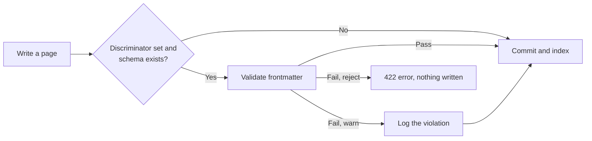

Schema validation keeps page types consistent. You write a JSON Schema for each type, such as `runbook` or `decision`, and KiwiFS checks the frontmatter of every page of that type before the write lands. Agents and people get an immediate error instead of leaving half-filled pages behind.

## How it works



1. A page declares its type in a discriminator field, `type` by default.
2. KiwiFS looks for `.kiwi/schemas/{value}.json`.
3. If that schema exists, the page's frontmatter is validated against it.
4. Pages with no discriminator, or with a type that has no schema, are never checked.

Validation runs inside the write pipeline, so it covers REST, MCP, imports, and the filesystem protocols alike. Only frontmatter is validated, not the page body.

## Turn on enforcement

```toml .kiwi/config.toml
[schema]
enforce = true
discriminator = "type"    # frontmatter field that names the schema
enforce_level = "reject"  # or "warn"
```

| Key | Default | Description |
| --- | --- | --- |
| `enforce` | `false` | Validate writes. While `false`, schemas are stored and served but never checked. |
| `discriminator` | `type` | Frontmatter field whose value picks the schema, for example `kind` or `category`. |
| `enforce_level` | `reject` | `reject` blocks invalid writes. `warn` logs the violation and lets the write through. |

<Tip>
Start with `enforce_level = "warn"` on an existing knowledge base. Fix the pages the server log reports, then switch to `reject`.
</Tip>

## Write a schema

Schemas are standard JSON Schema files, one per type. The filename without `.json` is the type value.

<Tree>
  <Tree.Folder name=".kiwi" defaultOpen>
    <Tree.Folder name="schemas" defaultOpen>
      <Tree.File name="runbook.json" />
      <Tree.File name="decision.json" />
    </Tree.Folder>
  </Tree.Folder>
</Tree>

<Tabs>
  <Tab title="REST">
    ```bash Terminal
    curl -X PUT 'http://localhost:3333/api/kiwi/schemas/runbook' \
      -H 'Content-Type: application/json' \
      -d '{
        "$schema": "http://json-schema.org/draft-07/schema#",
        "type": "object",
        "required": ["type", "title", "owner", "severity"],
        "properties": {
          "type": { "const": "runbook" },
          "title": { "type": "string", "minLength": 1 },
          "owner": { "type": "string" },
          "severity": { "type": "string", "enum": ["P1", "P2", "P3", "P4"] },
          "services": { "type": "array", "items": { "type": "string" } }
        }
      }'
    ```

    Saving through the API reloads the schemas immediately.
  </Tab>
  <Tab title="File on disk">
    Create `.kiwi/schemas/runbook.json` with the same JSON. Schemas edited on disk are picked up when the server restarts or when any schema is saved through the API.
  </Tab>
</Tabs>

Type names may contain letters, digits, hyphens, and underscores. Schema files are configuration, not pages: saving one does not create a git commit.

With that schema in place, this page is accepted:

```markdown runbooks/db-failover.md
---
type: runbook
title: Database failover
owner: team-platform
severity: P1
services: ["[[postgres-primary]]"]
---

## Steps
...
```

The `runbook`, `tasks`, `data`, `adr`, and other `kiwifs init` templates ship with schemas in `.kiwi/schemas/`. Enforcement stays off until you turn it on.

## Validation errors

With `enforce_level = "reject"`, an invalid write returns `422 Unprocessable Entity` and nothing is written. The message names the type and each violation:

```json 422 Unprocessable Entity
{
  "error": "validation failed: validation failed for type \"runbook\": at '': missing property 'owner'"
}
```

MCP write tools return the same message as a tool error, so agents can fix the frontmatter and retry.

## List and read schemas

```bash Terminal
curl 'http://localhost:3333/api/kiwi/schemas'
# ["decision","runbook"]

curl 'http://localhost:3333/api/kiwi/schemas/runbook'
# returns the raw JSON Schema document
```

## Related

<CardGroup cols={2}>
  <Card title="Schemas REST API" icon="shield-check" href="/api/schemas">
    List, read, and save schemas.
  </Card>
  <Card title="Configuration" icon="gear" href="/configuration#schema-enforcement">
    The `[schema]` section.
  </Card>
  <Card title="Templates" icon="copy" href="/guides/templates">
    Init templates that include schemas.
  </Card>
  <Card title="Files as truth" icon="file" href="/concepts/files-as-truth">
    Frontmatter as structured data.
  </Card>
</CardGroup>
