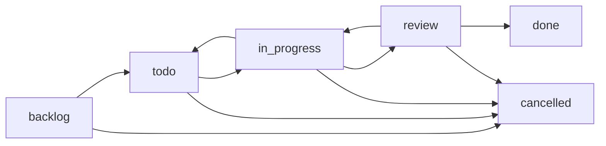

A workflow is a named state machine stored in `.kiwi/workflows/`. Pages join a workflow through two frontmatter fields, `workflow` and `state`. KiwiFS then moves them only along the transitions you allow, and the web UI shows them as a Kanban board.

Use workflows for task boards, editorial pipelines, review queues, or any process where a page should move through fixed stages.

## How it works



1. A definition in `.kiwi/workflows/{name}.json` lists the states and the allowed transitions.
2. A page opts in with `workflow: {name}` and a starting `state`.
3. Moving a card (or calling `POST /api/kiwi/workflow/advance`) checks the move against the definition, then updates the page's frontmatter through the write pipeline. Every move is a git commit.

## Definition format

```json .kiwi/workflows/tasks.json
{
  "name": "tasks",
  "states": [
    { "name": "backlog", "color": "#6b7280" },
    { "name": "todo", "color": "#3b82f6" },
    { "name": "in_progress", "color": "#f59e0b", "wip_limit": 5 },
    { "name": "review", "color": "#8b5cf6", "wip_limit": 3 },
    { "name": "done", "color": "#22c55e", "terminal": true },
    { "name": "cancelled", "color": "#ef4444", "terminal": true }
  ],
  "transitions": [
    { "from": "backlog", "to": "todo" },
    { "from": "todo", "to": "in_progress" },
    { "from": "in_progress", "to": "review" },
    { "from": "in_progress", "to": "todo" },
    { "from": "review", "to": "done" },
    { "from": "review", "to": "in_progress" }
  ]
}
```

<AccordionGroup>
  <Accordion title="State fields">
    | Field | Description |
    | --- | --- |
    | `name` | Required and unique within the workflow. Becomes a board column. |
    | `color` | Optional hex color for the column. |
    | `terminal` | Optional. Cards cannot leave a terminal state, and a terminal state may not have outbound transitions. |
    | `wip_limit` | Optional work-in-progress cap. Moving a card into a full column returns `409`. `0` means unlimited. |
  </Accordion>
  <Accordion title="Transition fields">
    | Field | Description |
    | --- | --- |
    | `from` | Source state. Must exist in `states`. |
    | `to` | Target state. Must exist in `states`. |
    | `required_role` | Optional label that is stored with the definition. It is not enforced today. |
  </Accordion>
</AccordionGroup>

KiwiFS validates a definition when you save it and when it loads the folder. Invalid files are skipped, and `GET /api/kiwi/workflows` lists their errors in an `errors` array. The `kiwifs init` templates `kb`, `tasks`, `cms`, `adr`, and `research` ship with a ready-made workflow.

## Page frontmatter

```markdown tasks/add-sso.md
---
title: Add SSO login
workflow: tasks
state: todo
priority: 2
due: 2026-11-01
tags: [auth]
blocked-by: [tasks/session-store.md]
---

Support SAML and OIDC providers.
```

The board reads these fields:

| Field | Purpose |
| --- | --- |
| `workflow`, `state` | Required. Place the page on a board and in a column. |
| `ordinal` | Position within the column. Set when you drag a card. |
| `title`, `priority`, `due`, `author`, `tags` or `labels` | Shown on the card. |
| `blocked-by` (or `blocked_by`) | Paths of pages that must reach a terminal state first. |
| `blocked`, `block_reason` | Manual block flag when there are no `blocked-by` references. |
| `depends_on` | Related pages, shown on the card. |

A card that is blocked cannot move to a state named `in_progress`; the move returns `409`. When a page has a `status` field that equals its old state, advancing updates `status` to the new state as well. Pages whose `state` matches no column appear under `__unmatched__` in the board response.

## Moving pages

<Tabs>
  <Tab title="Web UI">
    Click **Kanban** in the toolbar and pick a board. Drag cards between columns to advance them, or within a column to reorder them. Drag a page from the file tree onto a column to add it to the workflow. Use **New board**, **Edit columns**, and **Delete board** to manage definitions.
  </Tab>
  <Tab title="REST">
    ```bash Terminal
    # Add an existing page to a workflow
    curl -X POST 'http://localhost:3333/api/kiwi/workflow/assign' \
      -H 'Content-Type: application/json' \
      -d '{"path": "tasks/add-sso.md", "workflow": "tasks", "state": "backlog"}'

    # Move it along an allowed transition
    curl -X POST 'http://localhost:3333/api/kiwi/workflow/advance' \
      -H 'Content-Type: application/json' \
      -H 'X-Actor: agent:planner' \
      -d '{"path": "tasks/add-sso.md", "target_state": "todo"}'
    ```
  </Tab>
  <Tab title="MCP">
    Use `kiwi_workflow_advance` to move a page and `kiwi_workflow_board` to read the board. `kiwi_workflow_list`, `kiwi_workflow_get`, and `kiwi_workflow_save` manage definitions. `kiwi_task_create` creates a page already on the `tasks` workflow in `backlog`.
  </Tab>
</Tabs>

Advance returns `409` when the transition is not defined, the current state is terminal, the target column is at its WIP limit, or the card is blocked. Advancing to the state a page is already in returns `"noop": true`.

<Note>
`/workflow/advance` is the only path that checks a workflow definition. A plain file write can still set any `state`. To guard every write, add global transition rules under `[workflow]` in `config.toml` with `enforce_transitions = true`. See [Configuration](/configuration#workflow).
</Note>

## Pair workflows with claims

On a shared board, have agents [claim](/concepts/claims) a card before they work on it, then advance it. The claim tells other agents the card is taken; the workflow records where it is.

## Related

<CardGroup cols={2}>
  <Card title="Workflows REST API" icon="bars-progress" href="/api/workflows">
    Definitions, assign, advance, reorder, and board.
  </Card>
  <Card title="Task claims" icon="lock" href="/concepts/claims">
    Leases that stop agents from colliding on a card.
  </Card>
  <Card title="Webhooks" icon="webhook" href="/concepts/webhooks">
    Get a `transition` event when a page changes state.
  </Card>
  <Card title="Templates" icon="copy" href="/guides/templates">
    Init templates that ship with workflows.
  </Card>
</CardGroup>
