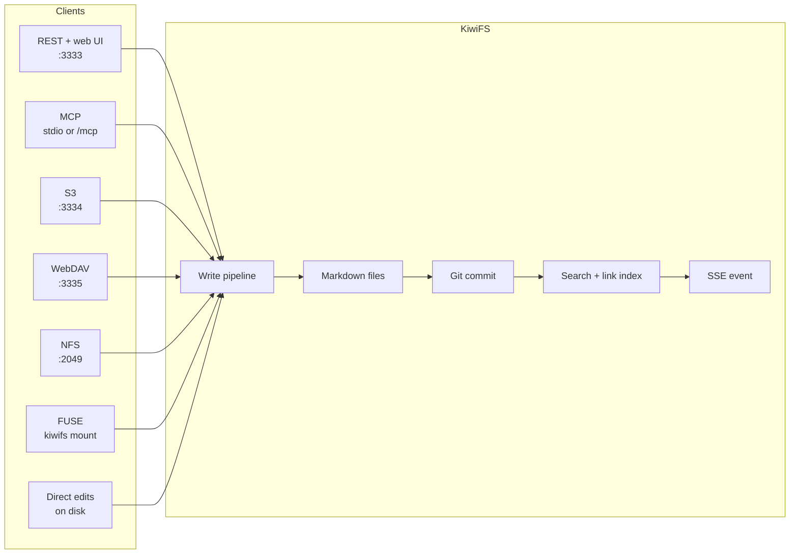

KiwiFS turns a folder of markdown files into a knowledge server. Agents and people read and write the same files over REST, MCP, NFS, S3, WebDAV, or a FUSE mount, and KiwiFS indexes, versions, and serves them through a built-in web UI.

The files on disk stay the source of truth. Search indexes, link graphs, and query caches are derived from them and can be rebuilt at any time.

## Why KiwiFS

- **Plain files, no lock-in.** Every page is a markdown file with YAML frontmatter. Copy the folder and you have everything.
- **Agents already know the interface.** Mount the folder and use `cat`, `grep`, and `echo`, or call the REST API or the 78 MCP tools.
- **Every write is a git commit.** History, blame, diff, and restore come for free, with the writer's identity as the commit author.
- **Search that works out of the box.** BM25 full-text search over SQLite FTS5 by default, with optional vector search through OpenAI, Ollama, Cohere, Voyage, Bedrock, Vertex, or any HTTP embedder.
- **Frontmatter you can query.** DQL runs SQL-like queries over frontmatter, and Bases save them as table and board views.
- **Restructure without breaking links.** Refactor plans move, merge, and split pages and rewrite every wiki link that pointed at them. Agents can plan and apply them over MCP, with approval thresholds for large changes.
- **Pages that explain.** Wiki links, steppable Mermaid, D2 diagrams rendered on the server, typed widget fences (arrays, trees, graphs, plots, timelines, and more), and quiz callouts whose answers stay out of search.
- **Built for many writers.** Optimistic concurrency with ETags, draft spaces, path claims, workflows, webhooks, and a live event stream.
- **One binary.** The Go server embeds the web UI. No Node, database, or Docker required.
- **Source available.** [BSL 1.1](https://github.com/kiwifs/kiwifs/blob/main/LICENSE): run it in production and embed it in your own products. Each release converts to Apache 2.0 after four years.

## How it works

Every write takes the same path no matter where it comes from: it lands on disk, becomes a git commit, updates the search and link indexes, and broadcasts an event to open web UIs and subscribers. A file watcher catches edits made directly on disk and sends them through the same pipeline.

The REST API, web UI, and MCP-over-HTTP endpoint share port `3333`. S3, WebDAV, and NFS stay off until you start the server with `--s3`, `--webdav`, or `--nfs`. See [Alternate protocols](/guides/alternate-protocols).

## For agents

These docs are published in machine-readable form:

- [`llms.txt`](https://docs.kiwifs.com/llms.txt): a short overview with key endpoints and MCP tool names.
- [`llms-full.txt`](https://docs.kiwifs.com/llms-full.txt): the full API, MCP, and CLI reference in one file.

A running KiwiFS server also serves its own `/llms.txt` and `/llms-full.txt` for the knowledge base it hosts. When auth is on, both list only public or published pages. See [Agent interface](/concepts/agent-interface#llms-txt).

## Next steps

<CardGroup cols={2}>
  <Card title="Quickstart" icon="rocket" href="/quickstart">
    Install KiwiFS, start a server, and make your first write.
  </Card>
  <Card title="Connect an agent over MCP" icon="plug" href="/concepts/mcp">
    Give Claude, Cursor, or any MCP client the 78 KiwiFS tools.
  </Card>
  <Card title="Agent interface" icon="robot" href="/concepts/agent-interface">
    Filesystem, REST, and MCP access patterns.
  </Card>
  <Card title="Widgets and diagrams" icon="puzzle-piece" href="/concepts/widgets">
    Typed widget fences, D2, Mermaid, and quiz callouts.
  </Card>
  <Card title="Web UI" icon="window" href="/guides/web-ui">
    Browse, edit, search, and visualize your knowledge base.
  </Card>
  <Card title="Configuration" icon="gear" href="/configuration">
    Every `.kiwi/config.toml` key and its default.
  </Card>
</CardGroup>
