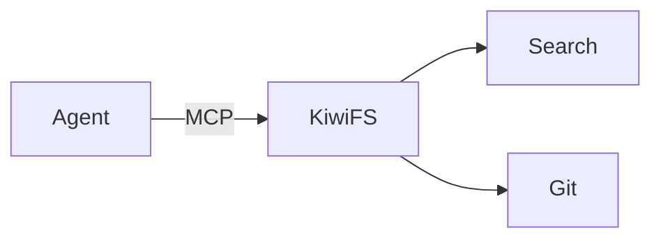

Pick a diagram block by what you need from it:

| Block | Use it when |
| --- | --- |
| [`graph`](#graph) | You want typed nodes and edges you can highlight per step: architecture, state machines, DAGs, algorithm graphs. |
| [`sequence`](#sequence) | You're showing messages between participants, one hop at a time. |
| [`steps`](#steps) | You already have a Mermaid diagram and want to walk a reader through it. |
| [`mermaid`](#mermaid) | You want a static Mermaid diagram, optionally with clickable nodes. |
| [`d2`](#d2) | You prefer D2's syntax and layout engines. |
| [Drawing embeds](#drawing-embeds) | The diagram is hand-drawn in Excalidraw or on a canvas. |

The typed fences (`graph`, `sequence`, `steps`) follow the shared rules for [steps, meta strings, playback, and validation](/concepts/widgets#writing-a-typed-fence).

## graph

Nodes and edges. Omit `x`/`y` and the `layout` places nodes for you: `dagre` for architecture and flow diagrams, `layered` for DAGs and trees, `circular` for small dense graphs. Refer to an edge as `"from->to"`, or give it an `id`. Nodes take shapes such as `person`, `cylinder`, `queue`, and `cloud`, and `groups` draws labelled containers behind their members.

A bare `graph` fence renders when its body has `nodes`. Also spelled `kiwi-graph`, `widget:graph`.

````markdown
```graph id=write-path caption="A write through the pipeline"
directed: true
layout: dagre
direction: LR
nodes:
  - {id: C, label: Client, shape: person}
  - {id: S, label: Storage, shape: cylinder}
  - {id: G, label: Git}
  - {id: I, label: Index, shape: cylinder}
  - {id: E, label: SSE}
edges:
  - {from: C, to: S}
  - {from: S, to: G}
  - {from: G, to: I}
  - {from: I, to: E}
steps:
  - note: "Bytes land on disk first — files are the source of truth."
    activeNodes: [S]
    dimNodes: [G, I, E]
  - note: "The commit makes that version addressable."
    activeNodes: [G]
    dimNodes: [I, E]
  - note: "Indexes are derivative, so they come last and can be rebuilt."
    activeNodes: [I, E]
```
````

<Accordion title="All 34 keys">

| Key | Type | Description |
| --- | --- | --- |
| `nodes` | array of object | **Required.** `{id, label?, sublabel?, shape?, x?, y?, color?, group?}`. Omit x/y to have the layout place the node. |
| `activeColor` | string | Primary highlight color. Fixed across steps. |
| `activeEdges` | array or number or string | Edge keys (`"from->to"` or `id`) active this step. |
| `activeNodes` | array or number or string | Node ids active this step. |
| `animate` | boolean | Glide nodes to new positions between steps. Default true. Fixed across steps. |
| `ariaLabel` | string | Accessible name. Defaults to a summary derived from the data. Fixed across steps. |
| `badges` | object | Small value at each node's corner: distance, degree, rank. |
| `dimEdges` | array or number or string | Dimmed edge keys. |
| `dimNodes` | array or number or string | Dimmed node ids. |
| `directed` | boolean | Draw arrowheads. Default false. Fixed across steps. |
| `direction` | `TB` \| `BT` \| `LR` \| `RL` | Dagre rank direction. Default TB. Fixed across steps. |
| `edgeColors` | object | Base color per edge key — tree vs back edges in a DFS. |
| `edges` | array of object | `{from, to, weight?, label?, id?, style?, color?, animated?, bidirectional?}`. |
| `editable` | boolean | Show a "copy as YAML" button that turns the laid-out graph into a fence body. Fixed across steps. |
| `flow` | `down` \| `up` | Layered layout: "up" draws edge targets on top (child → parent pointers). Fixed across steps. |
| `groups` | array of object | Labelled containers behind their members: `{id, label?, nodes?, parent?, color?}`. |
| `height` | number | Canvas height in px. Fixed across steps. |
| `highlightColor` | string | Secondary highlight color. Fixed across steps. |
| `highlightEdges` | array or number or string | Secondary-highlighted edge keys. |
| `highlightNodes` | array or number or string | Secondary-highlighted node ids. |
| `layout` | `force` \| `layered` \| `circular` \| `grid` \| `dagre` | Placement for nodes without x/y. "dagre" for architecture and flow diagrams, "layered" for DAGs and trees, "circular" for small dense graphs. Fixed across steps. |
| `nodeColors` | object | Base color per node id. |
| `nodeSize` | number | Node diameter in px. Default 36. Fixed across steps. |
| `nodeSpacing` | number | Dagre: gap between nodes in a rank, px. Default 36. Fixed across steps. |
| `packetDuration` | number | How long an untimed packet takes to cross its edge, ms. Default 900. Fixed across steps. |
| `packets` | array of object | Dots travelling along edges: `{edge, t?, label?, reverse?}`. |
| `pointers` | array of object | Labels beside nodes: `{id, label, color?}`. |
| `props` | any | Escape hatch for a widget prop whose name collides with a reserved key. |
| `rankSpacing` | number | Dagre: gap between ranks, px. Default 52. Fixed across steps. |
| `ring` | boolean or object | Draw a circular backdrop with tick marks: `true`, or `{ticks, labels}`. With `layout: circular` this is a hash ring — consistent hashing is a graph on a ring, not a widget of its own. |
| `shape` | string | Default node outline: circle, box, person, cylinder, queue, pill, cloud, … Fixed across steps. |
| `tokens` | array of object | Dots on the ring: `{at, label?, color?, degrees?}`. `at` is a fraction of the circumference from the top, clockwise, or a degree when `degrees: true`. |
| `width` | number | Canvas width in px. Fixed across steps. |
| `zoomable` | boolean | Wrap in a zoom / pan viewport. Fixed across steps. |

</Accordion>

## sequence

A message sequence between participants: API flows, consensus rounds, handshakes, retries. Each playback step reveals one more message, so `steps` only needs a `note` per message. `frames` draws grouping boxes such as `alt [cache miss]`.

A bare `sequence` fence renders when its body has `participants`. Also spelled `kiwi-sequence`, `widget:sequence`, `seq`.

````markdown
```sequence id=cache caption="Read-through cache on a miss"
participants:
  - {id: C, label: Client, shape: person}
  - {id: A, label: API}
  - {id: R, label: Redis, shape: cylinder}
  - {id: D, label: Postgres, shape: cylinder}
items:
  - {from: C, to: A, label: "GET /page/42"}
  - {from: A, to: R, label: "GET page:42"}
  - {from: R, to: A, label: "(nil)", kind: reply}
  - {from: A, to: D, label: "SELECT …"}
  - {from: D, to: A, label: row, kind: reply}
  - {from: A, to: R, label: "SETEX page:42 60", kind: async}
  - {from: A, to: C, label: "200 OK", kind: reply}
frames:
  - {kind: alt, label: "[cache miss]", from: 3, to: 5}
steps:
  - note: "The client asks for a page"
  - note: "The API checks Redis first"
  - note: "Miss — nothing cached"
  - note: "Fall through to Postgres"
  - note: "Row comes back"
  - note: "Populate the cache, without blocking the response"
  - note: "Respond. The next read is a hit."
```
````

<Accordion title="All 13 keys">

| Key | Type | Description |
| --- | --- | --- |
| `items` | array of object | **Required.** `{from, to, label?, kind?: "sync"\|"async"\|"reply"}`, or `{note, over}`, or `{divider}`. Fixed across steps. |
| `participants` | array of object | **Required.** `{id, label?, shape?, color?}` in left-to-right order. Fixed across steps. |
| `activeColor` | string | Primary highlight color. Fixed across steps. |
| `ariaLabel` | string | Accessible name. Defaults to a summary derived from the data. Fixed across steps. |
| `frames` | array of object | Grouping boxes: `{kind?, label?, from, to, color?}` — "alt [cache miss]", "loop". |
| `future` | `ghost` \| `hide` | How to draw items after the active one. Default ghost. Fixed across steps. |
| `highlightColor` | string | Secondary highlight color. Fixed across steps. |
| `numbered` | boolean | Prefix each message with its number. Fixed across steps. |
| `packet` | boolean | Move a dot along the active message. Default true. Fixed across steps. |
| `props` | any | Escape hatch for a widget prop whose name collides with a reserved key. |
| `step` | number | Items revealed so far; item `step - 1` is active. Defaults to one more per playback step. |
| `width` | number | Maximum display width, px. Fixed across steps. |
| `zoomable` | boolean | Wrap in a zoom / pan viewport. Fixed across steps. |

</Accordion>

## steps

A Mermaid diagram walked one step at a time. Each step can `focus` or `dim` node ids and carry a `note`. For a `sequenceDiagram`, each step reveals one more message unless you set `messages`. Unlike other typed fences, each step stands alone instead of patching the previous one.

A `steps` fence needs a non-empty `steps:` list.

A bare `steps` fence renders when its body has `diagram`. Also spelled `kiwi-steps`, `widget:steps`, `mermaid-steps`.

````markdown
```kiwi-steps id=write-path caption="A write through the pipeline"
diagram: |
  flowchart LR
    A[Client] --> B[Storage]
    B --> C[Git commit]
    C --> D[Index update]
    D --> E[SSE broadcast]
steps:
  - note: "The client PUTs a page"
    focus: [A]
    dim: [C, D, E]
  - note: "Bytes land on disk — files are the source of truth"
    focus: [B]
    dim: [D, E]
  - note: "The commit makes the version addressable"
    focus: [C]
    dim: [E]
  - note: "Indexes are derivative, so they come last"
    focus: [D, E]
```
````

<Accordion title="All 6 keys">

| Key | Type | Description |
| --- | --- | --- |
| `diagram` | string | **Required.** Mermaid source. Unchanged across steps. Fixed across steps. |
| `caption` | string | Caption under the diagram. Fixed across steps. |
| `dim` | array or string of string | Node ids to fade this step: a list, or `A, B`. |
| `focus` | array or string of string | Node ids to emphasise this step: a list, or `A, B`. |
| `kind` | `flowchart` \| `sequence` | Detected from the diagram's first line; set it only to override. Fixed across steps. |
| `messages` | number | Sequence diagrams: show the first N messages. Defaults to the step's position. |

</Accordion>

## mermaid

A standard ` ```mermaid ` block renders as a diagram. Add `focus=` or `dim=` to the opening line to emphasize or fade node ids, and use Mermaid's `click` directive to make a node open a page, a heading anchor, or an external URL.

````markdown

````

The linter rejects an empty `mermaid` block, or one whose first line isn't a Mermaid diagram type such as `flowchart`, `sequenceDiagram`, or `stateDiagram`. To step through a Mermaid diagram, use [`steps`](#steps).

## d2

A ` ```d2 ` block is rendered to SVG by the KiwiFS server, in-process, and follows the web UI's light or dark theme.

````markdown
```d2
direction: right
client: Client {shape: person}
api: API
db: Postgres {shape: cylinder}
client -> api: PUT /page
api -> db: commit
```
````

- **Layout.** `dagre` by default. Choose `elk` with D2's `vars: {d2-config: {layout-engine: elk}}`. Other engines aren't available.
- **Limits.** Source up to 64 KB, 10 seconds per render. `@import` is disabled.
- **Errors.** A diagram with a syntax error shows the source and D2's message. If the server can't render, for example a binary built with `-tags nod2`, the source is shown as a code block.

The web UI calls `/api/kiwi/render/d2`, which you can also use directly:

```bash Terminal
curl -X POST http://localhost:3333/api/kiwi/render/d2 \
  -H "Content-Type: application/json" \
  -d '{"source": "a -> b", "theme": "dark"}' \
  -o diagram.svg
```

`GET /api/kiwi/render/d2?source=...&theme=light` works too. The response is `image/svg+xml` with an `ETag`, and errors are `422` (diagram error), `400` (empty or too large), `503` (timeout), or `501` (built without D2).

## Drawing embeds

Embed an Excalidraw drawing (`.excalidraw.md`) or a canvas (`.canvas.json`) inline with a wiki embed. Add a width (`wide`, `full`), `pin` to keep it in view while the reader scrolls, a pixel size such as `600x400`, or caption text after the `|`.

```markdown
![[diagrams/architecture.excalidraw.md|wide]]

![[canvases/onboarding-flow.canvas.json|full pin]]
```

To add a caption to any media, wrap it in a [figure](/widgets/page-structure#figures).

## Related

<CardGroup cols={2}>
  <Card title="Widgets overview" icon="puzzle-piece" href="/concepts/widgets">
    Fence names, steps, playback, and validation.
  </Card>
  <Card title="Canvas" icon="object-group" href="/concepts/canvas">
    Spatial diagrams in `.canvas.json` files.
  </Card>
  <Card title="Whiteboard" icon="pen-ruler" href="/concepts/whiteboard">
    Freeform drawing in the web UI.
  </Card>
  <Card title="Data structures" icon="cubes" href="/widgets/data-structures">
    `tree`, `list`, and `map` for structures, not architecture.
  </Card>
</CardGroup>
